# Nido

Red social para compartir fotos y textos, hecha con Vue 3 y Node.js. La identidad sale del hornero y su nido de barro: el "me gusta" es un nido, y cada foto o texto se suma al nido de todos.

Junta lo mejor de las redes más usadas en una sola interfaz: las fotos y las historias de Instagram, los textos cortos y los hashtags de Twitter, y el perfil con estadísticas, privacidad y comentarios de las dos. Tiene portal web con barra lateral, modo oscuro y una versión pensada para el celular.

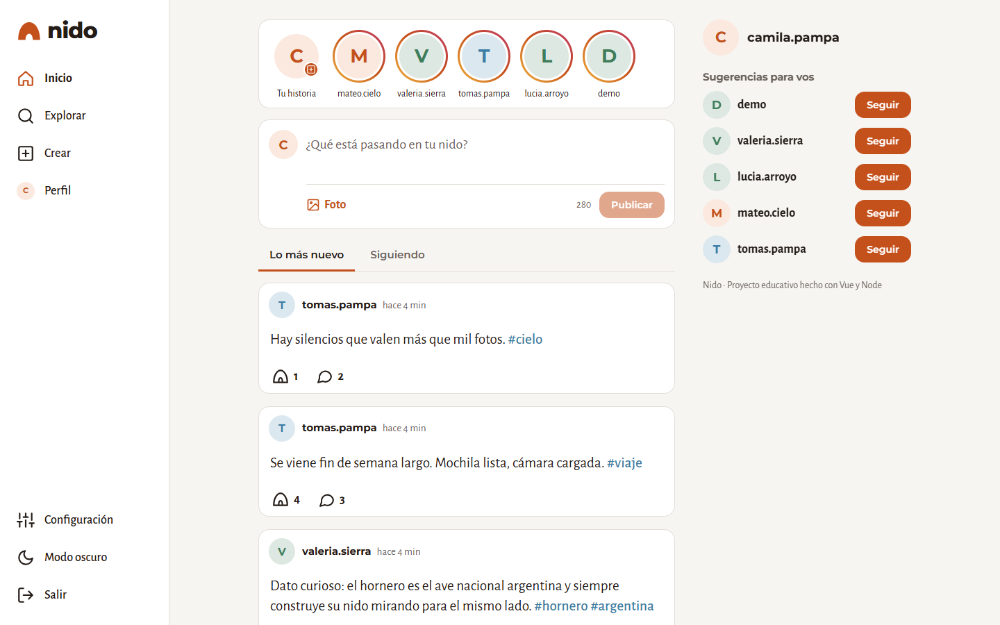

## Demo

Todas las capturas son del prototipo corriendo con datos de ejemplo (ver [Datos de demostración](#datos-de-demostración)).

### Entrar y registrarse

<table>
  <tr>
    <td>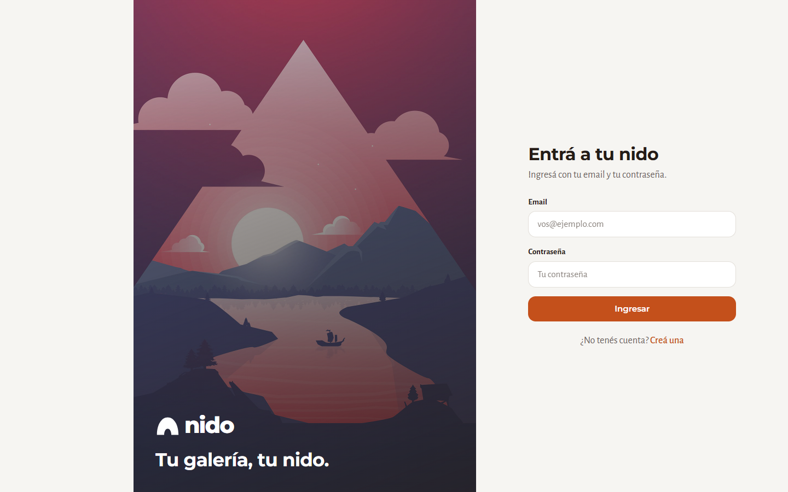</td>
    <td></td>
  </tr>
</table>

### Inicio: fotos y textos juntos, con historias

El feed mezcla fotos (estilo Instagram) y textos cortos (estilo Twitter), de la más nueva a la más vieja. Arriba están las historias y un cuadro para escribir sin salir del inicio. Con **doble clic** en cualquier publicación le das un hornero, y otro doble clic lo saca.

<table>
  <tr>
    <td>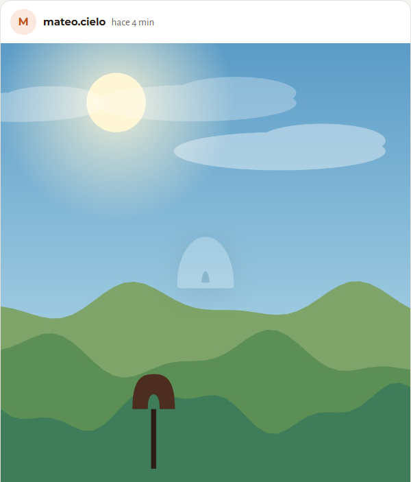</td>
    <td>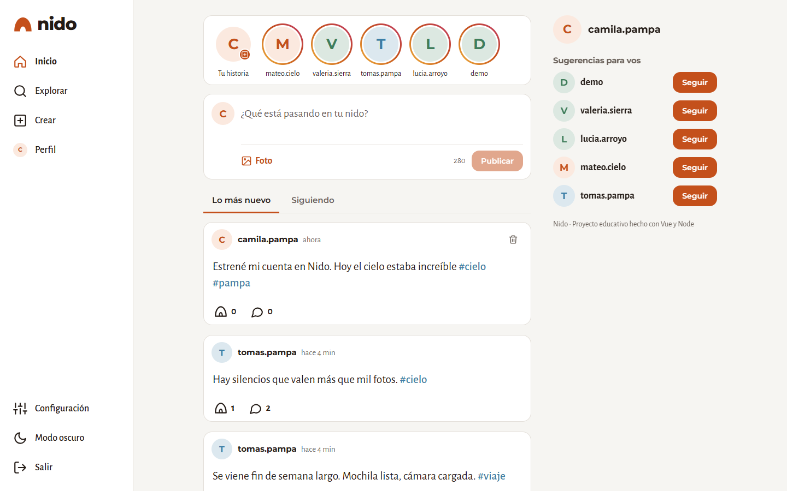</td>
  </tr>
  <tr>
    <td align="center">Doble clic en una foto</td>
    <td align="center">Texto publicado desde el inicio</td>
  </tr>
</table>

<table>
  <tr>
    <td>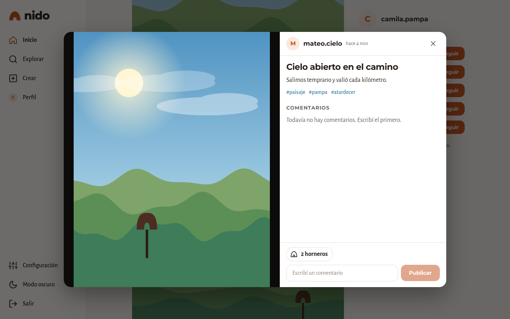</td>
    <td>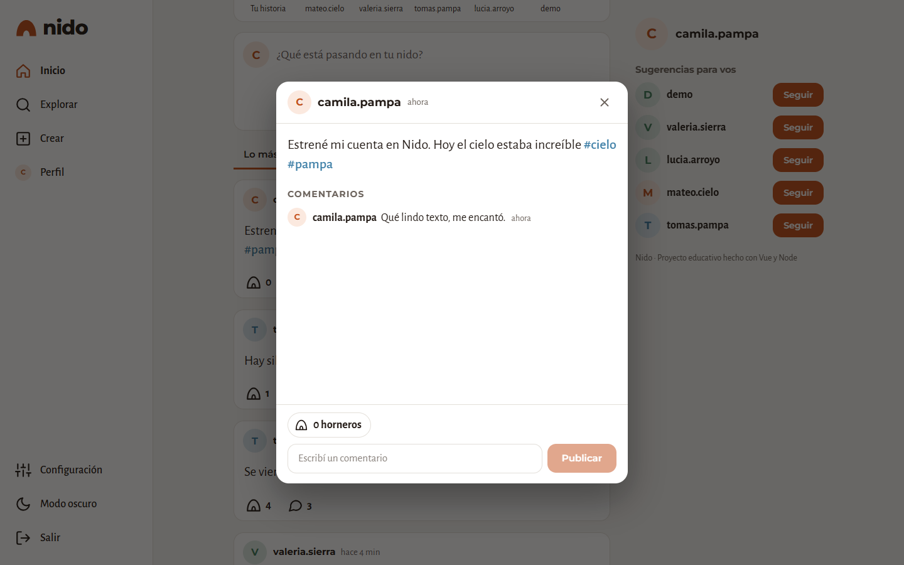</td>
  </tr>
  <tr>
    <td align="center">Foto con comentarios</td>
    <td align="center">Texto con comentarios</td>
  </tr>
</table>

### Historias de 24 horas

Se suben desde "Crear", aparecen arriba del inicio con un aro de color mientras no las viste, y el servidor las borra solas a las 24 horas.

<table>
  <tr>
    <td>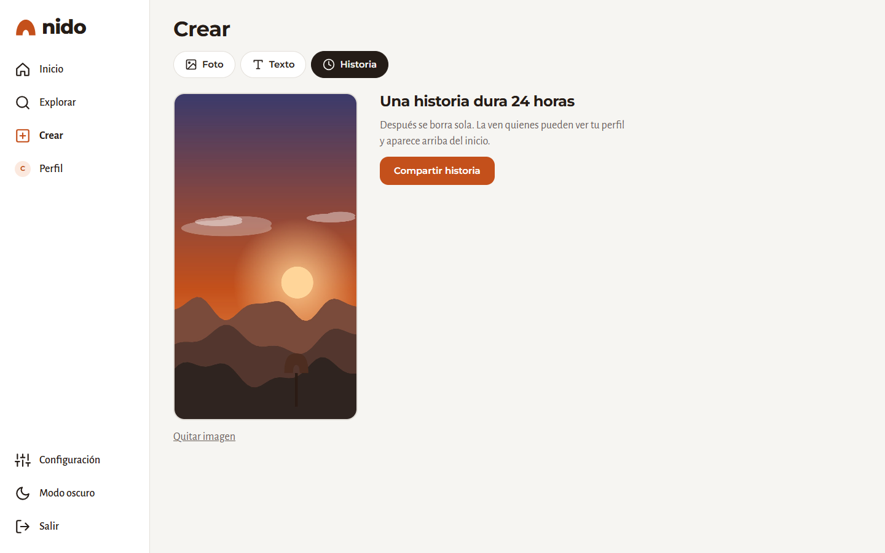</td>
    <td>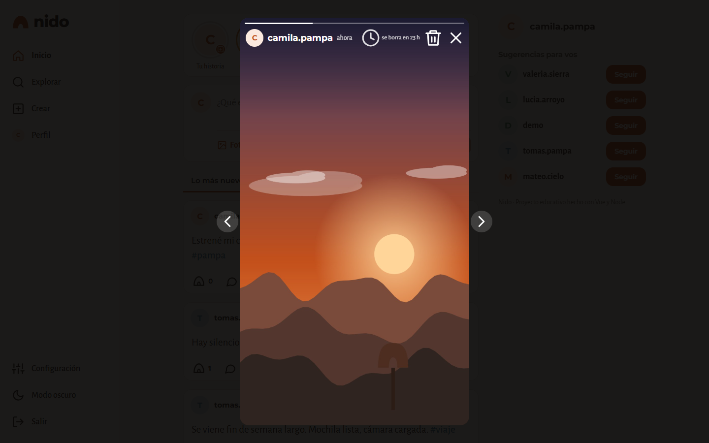</td>
  </tr>
  <tr>
    <td align="center">Crear una historia</td>
    <td align="center">Visor con barra de progreso y tiempo restante</td>
  </tr>
</table>

### Explorar y buscar personas

<table>
  <tr>
    <td>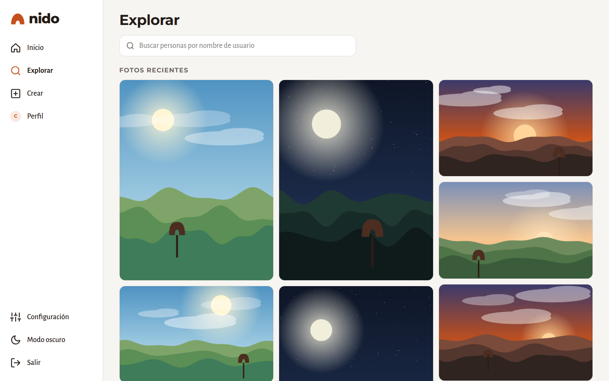</td>
    <td>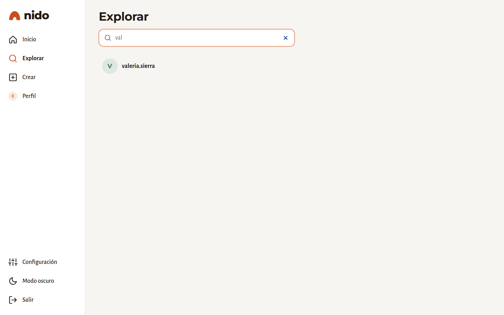</td>
  </tr>
</table>

### Perfiles y privacidad

Cada persona tiene su perfil con publicaciones, seguidores, seguidos y biografía. Las cuentas privadas solo muestran su contenido a quienes aprobó.

<table>
  <tr>
    <td>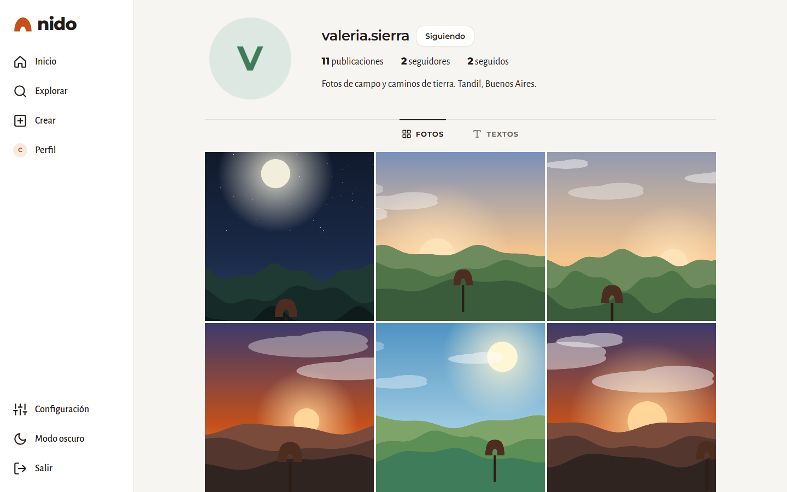</td>
    <td>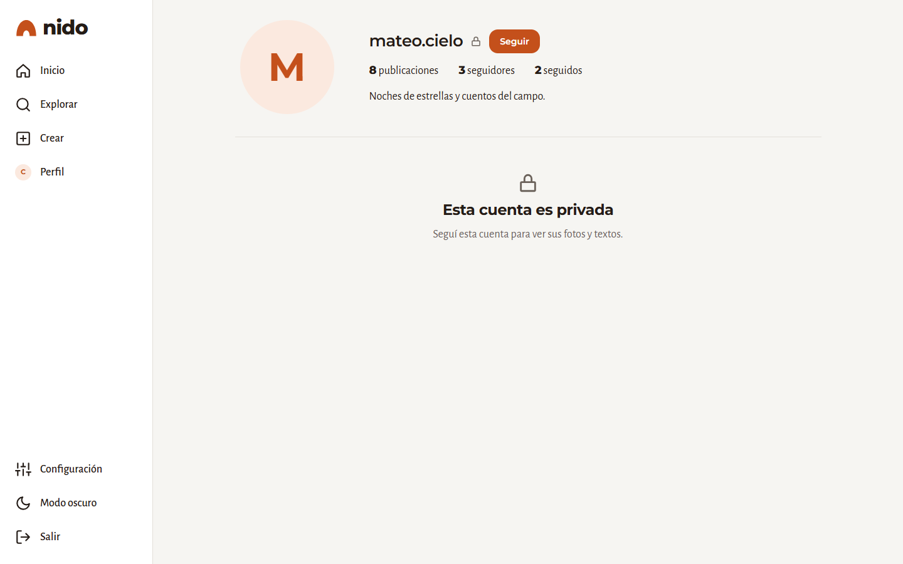</td>
  </tr>
  <tr>
    <td align="center">Perfil con grilla de fotos</td>
    <td align="center">Cuenta privada vista por quien no la sigue</td>
  </tr>
</table>

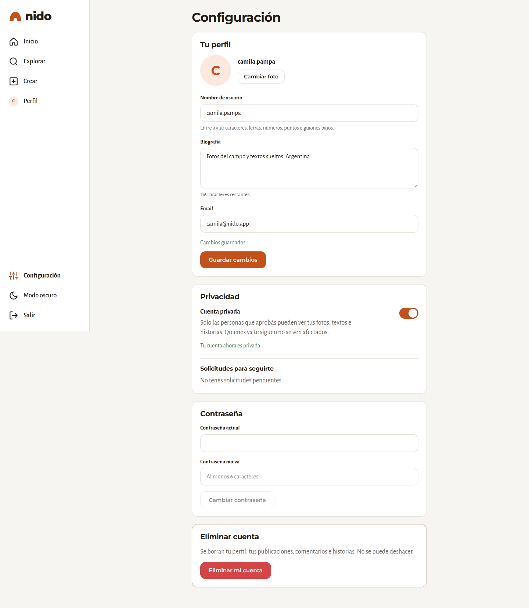

### Modo oscuro

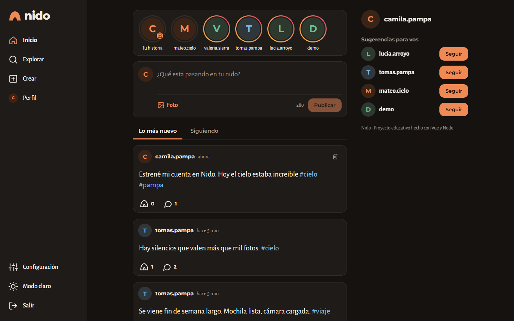

### En el celular

<table>
  <tr>
    <td>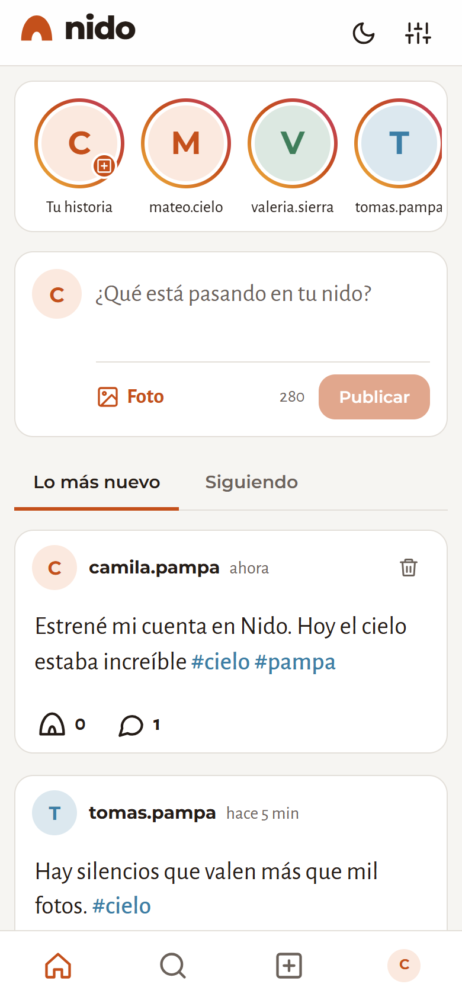</td>
    <td>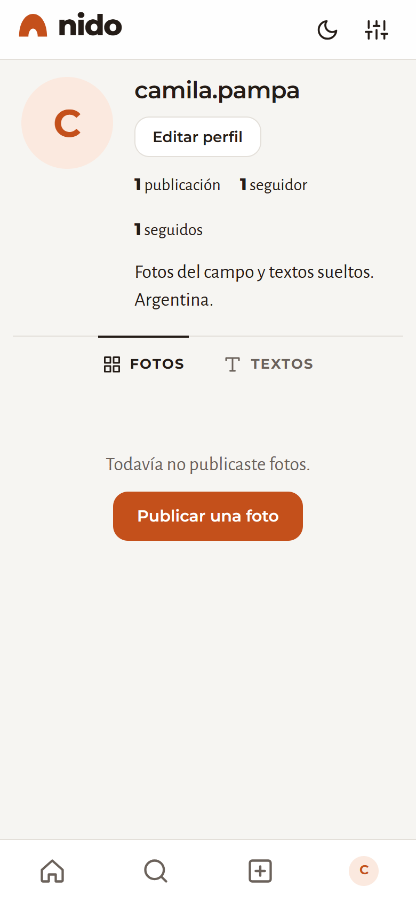</td>
    <td>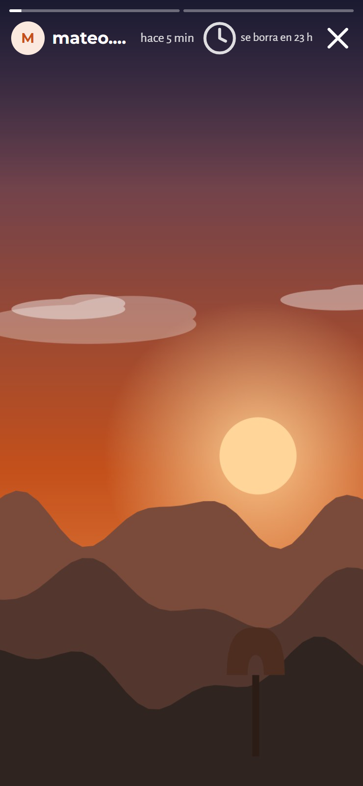</td>
  </tr>
</table>

## Qué puede hacer hoy

**Publicar**
- Fotos con título, descripción y etiquetas, con vista previa y arrastrar y soltar.
- Textos de hasta 280 caracteres (como un tuit). Los `#hashtags` se resaltan y quedan como etiquetas.
- Historias que se borran a las 24 horas.
- Borrar tus propias publicaciones e historias.

**Interactuar**
- Hornero (me gusta) con un toque o con doble clic. Otro doble clic lo saca. El total se actualiza en todas las pantallas.
- Comentarios en fotos y textos.
- Seguir y dejar de seguir. El inicio tiene dos pestañas: **Lo más nuevo** (todo, fotos y textos mezclados) y **Siguiendo**.

**Perfiles**
- Ver el perfil de cualquier persona: publicaciones, seguidores, seguidos, biografía, grilla de fotos y pestaña de textos.
- Buscar personas por nombre de usuario y recibir sugerencias de a quién seguir.

**Configuración y privacidad**
- Cambiar la foto de perfil, el nombre de usuario y la biografía.
- **Cuenta privada**: solo quienes aprobás ven tus fotos, textos, comentarios e historias. Seguir una cuenta privada envía una solicitud que se acepta o se rechaza desde Configuración. Al volver pública la cuenta, las solicitudes pendientes se aceptan.
- Cambiar la contraseña y eliminar la cuenta con todo su contenido.

**Portal web y celular**
- Barra lateral con navegación (se reduce a íconos en tablet), columna central con el feed y panel de sugerencias a la derecha.
- En el celular: barra superior, navegación inferior y las mismas pantallas adaptadas.
- Modo claro y oscuro, que se recuerda.

Lo que sigue está en la [hoja de ruta](#hoja-de-ruta).

## Tecnologías

| Parte | Tecnología |
|---|---|
| Cliente (`client/`) | Vue 3, Vue Router, Vuex, Axios, CSS con variables |
| Servidor (`server/`) | Node.js, Express, MySQL o MariaDB, JWT, bcrypt, Multer |
| Tipografías | Montserrat (títulos) y Alegreya Sans (texto), de Google Fonts |

## Estructura

```
nido-vue/
├── client/                  # Aplicación Vue
│   ├── public/              # index.html, íconos y favicon
│   └── src/
│       ├── assets/styles/   # tokens.css (paleta y fuentes) y base.css
│       ├── components/      # PostCard, StoriesBar, StoryViewer, Composer, FollowButton...
│       ├── lib/             # Fechas relativas y apertura de publicaciones
│       ├── router/          # Rutas y protección de páginas
│       ├── store/           # Sesión y me gusta (Vuex)
│       ├── views/           # Inicio, Explorar, Crear, Perfil, Configuración, Publicación, Login, Registro
│       └── api.js           # Cliente HTTP (lee VUE_APP_API_URL)
├── server/                  # API REST
│   ├── resources/           # users.js, post.js y stories.js
│   ├── lib/helpers.js       # Reglas de visibilidad (cuentas privadas) y borrado de archivos
│   ├── migrations/          # Cambios de la base para instalaciones existentes
│   ├── scripts/seed.js      # Datos de demostración
│   └── index.js             # Arranque, base de datos y autenticación
├── docs/screenshots/        # Capturas de este README
└── nido.sql                 # Estructura de la base de datos
```

## Cómo correrlo

Necesitás Node.js 18 o superior y MySQL o MariaDB.

### 1. Base de datos

```sql
CREATE DATABASE nido CHARACTER SET utf8mb4;
```

```bash
mysql -u <usuario> -p nido < nido.sql
```

El dump incluye un usuario de prueba: `demo@nido.app` con contraseña `demo1234`.

> **¿Ya tenías la base de una versión anterior?** En lugar de importar `nido.sql`, corré la migración: `mysql -u <usuario> -p nido < server/migrations/001-texto-historias-seguidores.sql`. Agrega los textos, las historias, los seguidores y la privacidad sin perder datos. Si hay emails o nombres de usuario repetidos, corregilos antes, porque pasan a ser únicos.

### 2. Servidor

```bash
cd server
cp .env.example .env      # en Windows: copy .env.example .env
npm install
npm start
```

Completá `server/.env` antes de arrancar. `JWT_SECRET` y `DB_USER` son obligatorias; sin ellas el servidor no inicia. El servidor queda en `http://localhost:4000`.

### 3. Cliente

```bash
cd client
cp .env.example .env      # en Windows: copy .env.example .env
npm install
npm run serve
```

La aplicación queda en `http://localhost:8080`.

## Variables de entorno

**Servidor** (`server/.env`)

| Variable | Descripción | Por defecto |
|---|---|---|
| `JWT_SECRET` | Secreto para firmar los tokens. Obligatoria. | |
| `DB_USER` | Usuario de la base de datos. Obligatoria. | |
| `DB_PASSWORD` | Contraseña de la base de datos. | vacía |
| `DB_HOST` | Servidor de la base de datos. | `localhost` |
| `DB_PORT` | Puerto de la base de datos. | `3306` |
| `DB_NAME` | Nombre de la base. | `nido` |
| `PORT` | Puerto del servidor. | `4000` |
| `CORS_ORIGIN` | Orígenes permitidos, separados por coma. | cualquiera |

Para generar un secreto:

```bash
node -e "console.log(require('crypto').randomBytes(48).toString('hex'))"
```

**Cliente** (`client/.env`)

| Variable | Descripción | Por defecto |
|---|---|---|
| `VUE_APP_API_URL` | URL del servidor. | `http://localhost:4000` |

## Datos de demostración

Con el servidor corriendo, este comando crea cuatro usuarios con biografía, publica fotos y textos, arma seguidores, sube historias, y agrega horneros y comentarios al azar:

```bash
cd server
npm run seed
```

Las fotos y las historias son paisajes ilustrados que se generan en el momento con la paleta de Nido, así que no dependen de ninguna fuente externa. Podés ajustar las cantidades y la dirección del servidor:

```bash
POSTS=24 TEXTS=12 STORIES=8 API_URL=http://localhost:4000 npm run seed
```

Los usuarios creados son `valeria@nido.app`, `tomas@nido.app`, `lucia@nido.app` y `mateo@nido.app`, todos con la contraseña `nido1234` (se puede cambiar con `SEED_PASSWORD`). El script se puede ejecutar varias veces: si un usuario ya existe, inicia sesión con él.

Las imágenes subidas se guardan en `server/public/uploads/` y no se suben a git.

## Reglas importantes

- **Privacidad:** el servidor es quien aplica la privacidad, no el cliente. Una cuenta privada solo muestra sus publicaciones, comentarios e historias a ella misma y a sus seguidores aceptados. Para el resto, esas publicaciones no aparecen en el feed, en Explorar ni en la API, y abrirlas por su dirección devuelve "no encontrada".
- **Historias:** duran 24 horas. La API deja de mostrarlas en ese momento y el servidor borra la fila y el archivo cada 10 minutos (y al arrancar).
- **Imágenes:** solo se aceptan imágenes de hasta 10 MB.
- **Fechas:** se guardan y se leen en UTC, y el cliente las muestra como "hace 5 min".
- **Nombre de usuario:** entre 3 y 30 caracteres: letras, números, puntos o guiones bajos. Es único, igual que el email.

## API

Las rutas marcadas con 🔒 requieren el token en el encabezado `Authorization`. Las demás funcionan sin iniciar sesión, pero respetan la privacidad según quién consulta.

**Cuenta**

| Método | Ruta | Descripción |
|---|---|---|
| POST | `/api/users/register` | Crea una cuenta. Recibe `username`, `email` y `password`. |
| POST | `/api/users/login` | Inicia sesión. Recibe `email` y `password`. |
| GET | `/api/users/profile` 🔒 | Datos de tu cuenta. |
| PUT | `/api/users/profile` 🔒 | Edita `username`, `bio` e `is_private`. |
| POST | `/api/users/avatar` 🔒 | Sube la foto de perfil (archivo `avatar`). |
| DELETE | `/api/users/avatar` 🔒 | Quita la foto de perfil. |
| PUT | `/api/users/password` 🔒 | Cambia la contraseña (`current` y `next`). |
| DELETE | `/api/users/account` 🔒 | Elimina la cuenta (requiere `password`). |

**Personas**

| Método | Ruta | Descripción |
|---|---|---|
| GET | `/api/users/:id` | Perfil público: estadísticas, biografía, estado de seguimiento y si podés ver su contenido. |
| GET | `/api/users/search?q=` | Busca por nombre de usuario. |
| GET | `/api/users/suggestions` 🔒 | Personas para seguir. |
| POST | `/api/users/:id/follow` 🔒 | Sigue (o envía solicitud si la cuenta es privada). |
| DELETE | `/api/users/:id/follow` 🔒 | Deja de seguir o cancela la solicitud. |
| GET | `/api/users/requests` 🔒 | Solicitudes de seguimiento que recibiste. |
| POST | `/api/users/requests/:id/accept` 🔒 | Acepta una solicitud. |
| DELETE | `/api/users/requests/:id` 🔒 | Rechaza una solicitud. |

**Publicaciones**

| Método | Ruta | Descripción |
|---|---|---|
| GET | `/api/posts` | Lista, de la más nueva a la más vieja. Filtros: `kind=image\|text`, `user=<id>`, `feed=following`, `limit`, `offset`. |
| GET | `/api/posts/:id` | Una publicación. |
| POST | `/api/posts` 🔒 | Publica una foto. Formulario con `source` (archivo), `title`, `description` y `tags`. |
| POST | `/api/posts/text` 🔒 | Publica un texto de hasta 280 caracteres (`text`). |
| DELETE | `/api/posts/:id` 🔒 | Borra una publicación propia. |
| GET | `/api/posts/likes` 🔒 | Identificadores de lo que te gustó. |
| POST | `/api/posts/like/:postId` 🔒 | Da el hornero; si ya lo diste, lo saca. Devuelve `liked` y el total. |
| GET | `/api/posts/:id/comments` | Comentarios de una publicación. |
| POST | `/api/posts/:id/comments` 🔒 | Comenta (`comment`). |

**Historias**

| Método | Ruta | Descripción |
|---|---|---|
| GET | `/api/stories` | Historias activas (últimas 24 horas), agrupadas por persona. Las tuyas van primero. |
| POST | `/api/stories` 🔒 | Sube una historia (archivo `source`). |
| DELETE | `/api/stories/:id` 🔒 | Borra una historia propia. |

## Diseño

- **Paleta:** naranja hornero como único acento, barro para el texto, pampa verde, cielo azul y un fondo arena. Todo está en `client/src/assets/styles/tokens.css` como variables, con su versión oscura.
- **Tipografía:** Montserrat para títulos y botones, y Alegreya Sans para el texto.
- **Íconos:** un conjunto propio de trazos simples. El "me gusta" es el nido de hornero.
- **Responsive:** tres modos. Escritorio con barra lateral completa y panel de sugerencias; tablet con barra lateral de íconos; celular con barra superior e inferior.

## Hoja de ruta

Lo que ya está hecho:

- [x] Seguridad básica y configuración por variables de entorno
- [x] Identidad visual: paleta, tipografía, íconos, modo claro y oscuro
- [x] Rediseño de todas las pantallas, versión celular incluida
- [x] Publicaciones de solo texto y feed que mezcla fotos y textos
- [x] Hornero con doble clic (da y saca)
- [x] Historias que se borran a las 24 horas
- [x] Perfiles, seguidores, pestaña Siguiendo, búsqueda y sugerencias
- [x] Configuración del perfil, cuenta privada con solicitudes y baja de cuenta

Lo que sigue:

- [ ] Notificaciones (horneros, comentarios, nuevos seguidores y solicitudes)
- [ ] Listas de seguidores y seguidos, y bloquear personas
- [ ] Respuestas dentro de los comentarios y menciones con `@`
- [ ] Páginas de etiquetas y tendencias
- [ ] Scroll infinito con paginación en el cliente
- [ ] Guardar publicaciones en colecciones
- [ ] Mensajes directos
- [ ] Comunidades ("nidos")
- [ ] Publicación en línea con datos de ejemplo

## Notas

- Este es un proyecto personal y educativo. No es un producto de ninguna otra red social.
- Las contraseñas del dump y del script de datos son solo para pruebas. No las uses en un entorno público.
