# Nido

Red social para compartir fotos, hecha con Vue 3 y Node.js. La identidad sale del hornero y su nido de barro: el "me gusta" es un nido y los usuarios llenan el feed de a una foto por vez.

Está inspirada en lo mejor de las redes más usadas (el feed visual de Instagram, las etiquetas de Twitter, los comentarios de Facebook) y lo junta en una interfaz propia, con modo oscuro y pensada para el celular.

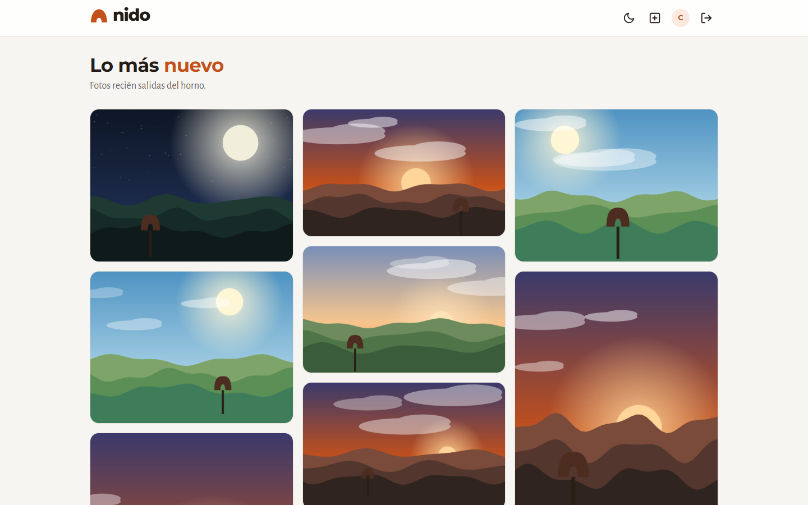

## Demo

Todas las capturas son del prototipo corriendo con datos de ejemplo (ver [Datos de demostración](#datos-de-demostración)).

### Entrar y registrarse

<table>
  <tr>
    <td></td>
    <td>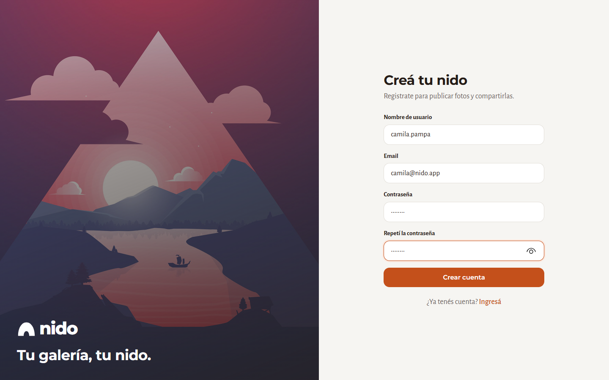</td>
  </tr>
  <tr>
    <td align="center">Ingreso</td>
    <td align="center">Registro</td>
  </tr>
</table>

### Feed y publicaciones

<table>
  <tr>
    <td>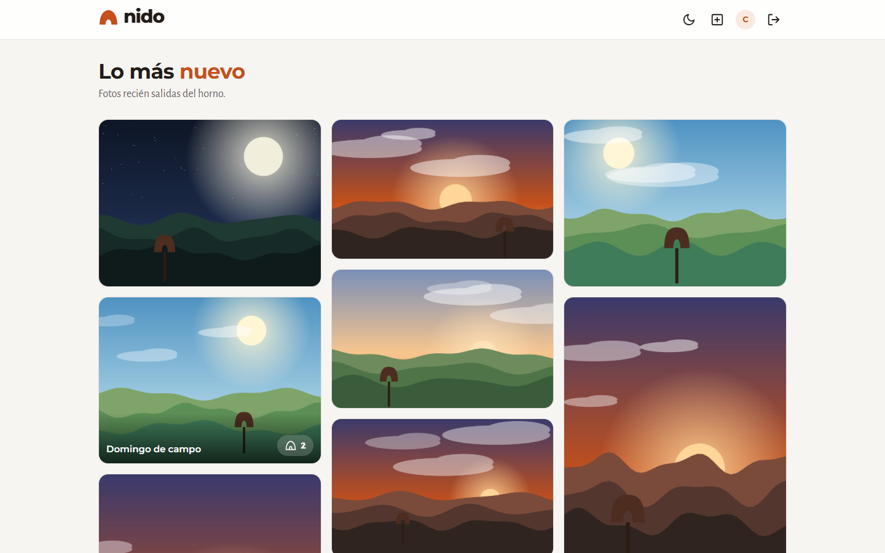</td>
    <td>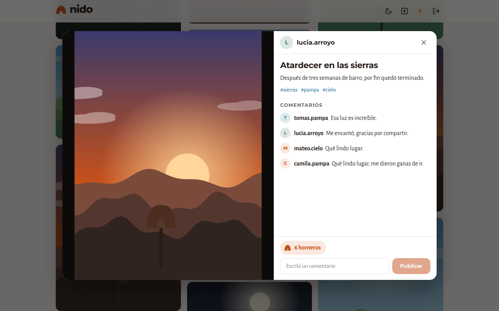</td>
  </tr>
  <tr>
    <td align="center">Grilla tipo mosaico, con me gusta al pasar el mouse</td>
    <td align="center">Publicación con comentarios y me gusta</td>
  </tr>
</table>

### Publicar y perfil

<table>
  <tr>
    <td>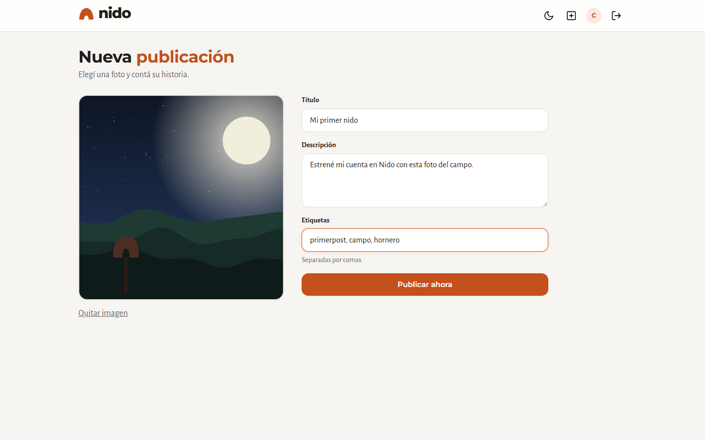</td>
    <td>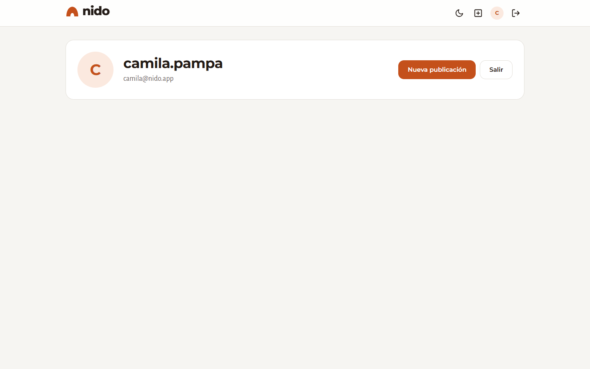</td>
  </tr>
  <tr>
    <td align="center">Subir una foto con vista previa</td>
    <td align="center">Perfil</td>
  </tr>
</table>

### Modo oscuro

<table>
  <tr>
    <td>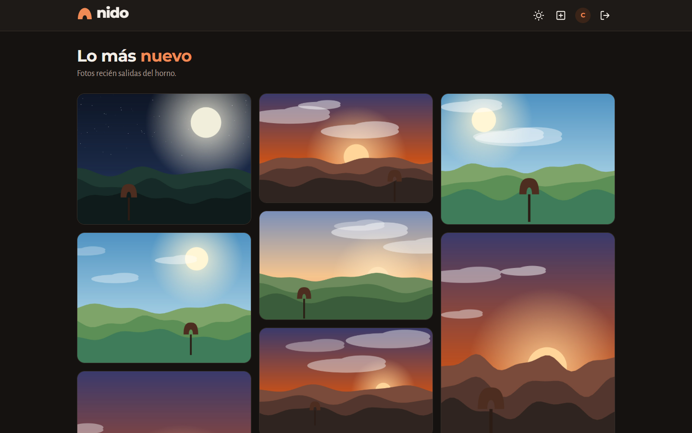</td>
    <td>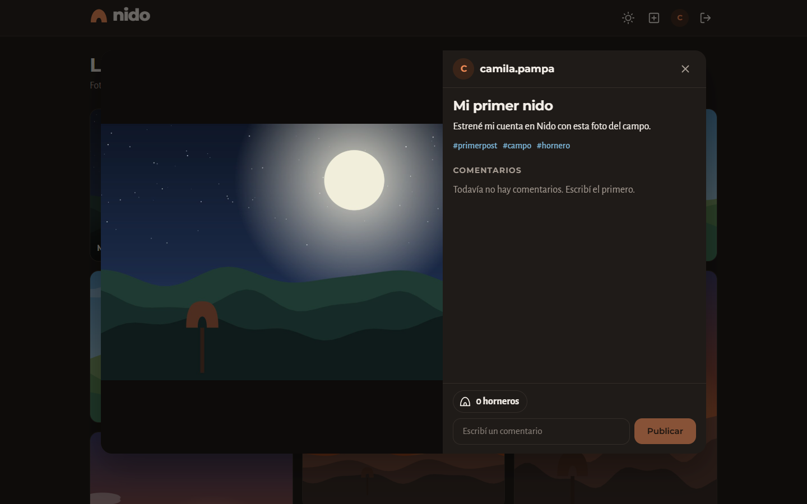</td>
  </tr>
</table>

### En el celular

<table>
  <tr>
    <td>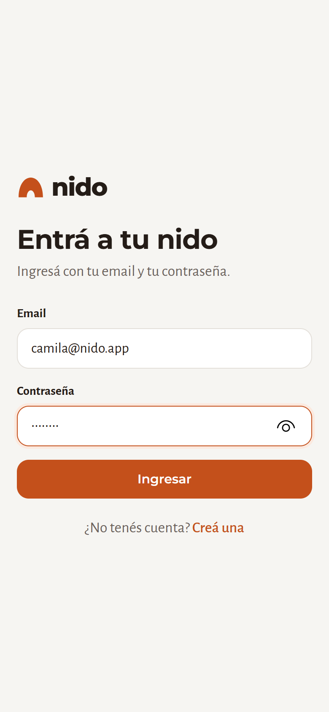</td>
    <td>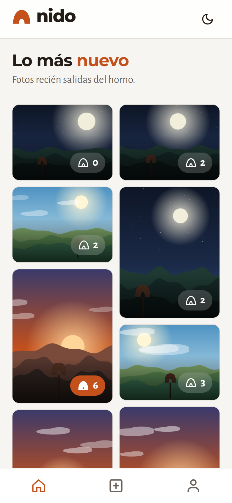</td>
    <td>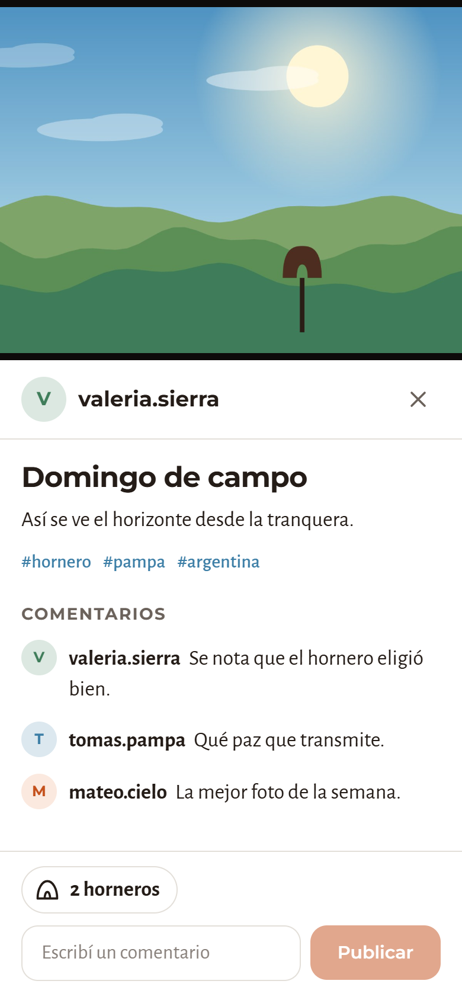</td>
  </tr>
</table>

## Qué puede hacer hoy

- Crear una cuenta, iniciar y cerrar sesión (contraseñas con bcrypt, sesión con JWT de 7 días).
- Ver el feed de publicaciones públicas en una grilla tipo mosaico, con estados de carga, vacío y error.
- Subir una foto con título, descripción y etiquetas, con vista previa y arrastrar y soltar.
- Dar me gusta (un solo me gusta por persona) y comentar desde la publicación abierta.
- Cambiar entre modo claro y oscuro (se recuerda la elección) y usarlo desde el celular con barra de navegación inferior.

Lo que sigue está en la [hoja de ruta](#hoja-de-ruta).

## Tecnologías

| Parte | Tecnología |
|---|---|
| Cliente (`client/`) | Vue 3, Vue Router, Vuex, Axios, CSS con variables |
| Servidor (`server/`) | Node.js, Express, MySQL o MariaDB, JWT, bcrypt, Multer |
| Tipografías | Montserrat (títulos) y Alegreya Sans (texto), de Google Fonts |

## Estructura

```
nido-vue/
├── client/                  # Aplicación Vue
│   ├── public/              # index.html, íconos y favicon
│   └── src/
│       ├── assets/styles/   # tokens.css (paleta y fuentes) y base.css
│       ├── components/      # NidoLogo, Icon, Avatar, AuthLayout, ImageUpload
│       ├── router/          # Rutas y protección de páginas
│       ├── store/           # Sesión (Vuex)
│       ├── views/           # Feed, Publicación, Login, Registro, Subir, Perfil
│       └── api.js           # Cliente HTTP (lee VUE_APP_API_URL)
├── server/                  # API REST
│   ├── resources/           # users.js y post.js
│   ├── scripts/seed.js      # Datos de demostración
│   └── index.js             # Arranque, base de datos y autenticación
├── docs/screenshots/        # Capturas de este README
└── nido.sql                 # Estructura de la base de datos
```

## Cómo correrlo

Necesitás Node.js 18 o superior y MySQL o MariaDB.

### 1. Base de datos

```sql
CREATE DATABASE nido CHARACTER SET utf8mb4;
```

```bash
mysql -u <usuario> -p nido < nido.sql
```

El dump incluye un usuario de prueba: `demo@nido.app` con contraseña `demo1234`.

### 2. Servidor

```bash
cd server
cp .env.example .env      # en Windows: copy .env.example .env
npm install
npm start
```

Completá `server/.env` antes de arrancar. `JWT_SECRET` y `DB_USER` son obligatorias; sin ellas el servidor no inicia. El servidor queda en `http://localhost:4000`.

### 3. Cliente

```bash
cd client
cp .env.example .env      # en Windows: copy .env.example .env
npm install
npm run serve
```

La aplicación queda en `http://localhost:8080`.

## Variables de entorno

**Servidor** (`server/.env`)

| Variable | Descripción | Por defecto |
|---|---|---|
| `JWT_SECRET` | Secreto para firmar los tokens. Obligatoria. | |
| `DB_USER` | Usuario de la base de datos. Obligatoria. | |
| `DB_PASSWORD` | Contraseña de la base de datos. | vacía |
| `DB_HOST` | Servidor de la base de datos. | `localhost` |
| `DB_PORT` | Puerto de la base de datos. | `3306` |
| `DB_NAME` | Nombre de la base. | `nido` |
| `PORT` | Puerto del servidor. | `4000` |
| `CORS_ORIGIN` | Orígenes permitidos, separados por coma. | cualquiera |

Para generar un secreto:

```bash
node -e "console.log(require('crypto').randomBytes(48).toString('hex'))"
```

**Cliente** (`client/.env`)

| Variable | Descripción | Por defecto |
|---|---|---|
| `VUE_APP_API_URL` | URL del servidor. | `http://localhost:4000` |

## Datos de demostración

Con el servidor corriendo, este comando crea cuatro usuarios, publica fotos de ejemplo, y agrega me gusta y comentarios al azar:

```bash
cd server
npm run seed
```

Las fotos son paisajes ilustrados que se generan en el momento con la paleta de Nido, así que no dependen de ninguna fuente externa. Podés ajustar la cantidad y la dirección del servidor:

```bash
POSTS=24 API_URL=http://localhost:4000 npm run seed
```

Los usuarios creados son `valeria@nido.app`, `tomas@nido.app`, `lucia@nido.app` y `mateo@nido.app`, todos con la contraseña `nido1234` (se puede cambiar con `SEED_PASSWORD`). El script se puede ejecutar varias veces: si un usuario ya existe, inicia sesión con él.

Las imágenes subidas se guardan en `server/public/uploads/` y no se suben a git.

## API

Las rutas marcadas con 🔒 requieren el token en el encabezado `Authorization`.

| Método | Ruta | Descripción |
|---|---|---|
| POST | `/api/users/register` | Crea una cuenta. Recibe `username`, `email` y `password`. |
| POST | `/api/users/login` | Inicia sesión. Recibe `email` y `password`. |
| GET | `/api/users/profile` 🔒 | Datos de la cuenta con la sesión iniciada. |
| GET | `/api/users/:id` | Nombre público de un usuario. |
| GET | `/api/posts` | Publicaciones públicas, de la más nueva a la más vieja. |
| GET | `/api/posts/:id` | Una publicación. |
| POST | `/api/posts` 🔒 | Publica una foto. Formulario con `source` (archivo), `title`, `description` y `tags`. |
| GET | `/api/posts/likes` 🔒 | Identificadores de las publicaciones que te gustaron. |
| POST | `/api/posts/like/:postId` 🔒 | Da me gusta. |
| GET | `/api/posts/:id/comments` | Comentarios de una publicación. |
| POST | `/api/posts/:id/comments` 🔒 | Comenta. Recibe `comment`. |

## Diseño

- **Paleta:** naranja hornero como único acento, barro para el texto, pampa verde, cielo azul y un fondo arena. Todo está en `client/src/assets/styles/tokens.css` como variables, con su versión oscura.
- **Tipografía:** Montserrat para títulos y botones, y Alegreya Sans para el texto.
- **Íconos:** un conjunto propio de trazos simples. El "me gusta" es el nido de hornero.
- **Responsive:** en pantallas chicas el feed pasa a dos columnas y aparece una barra de navegación inferior.

## Hoja de ruta

Lo que ya está hecho:

- [x] Seguridad básica y configuración por variables de entorno
- [x] Identidad visual: paleta, tipografía, íconos, modo claro y oscuro
- [x] Rediseño de todas las pantallas, versión celular incluida

Lo que sigue:

- [ ] Perfil completo con foto, descripción y grilla de publicaciones
- [ ] Seguir personas y un feed con las publicaciones de quienes seguís
- [ ] Búsqueda de usuarios y etiquetas, con tendencias
- [ ] Publicaciones de solo texto
- [ ] Notificaciones y respuestas dentro de los comentarios
- [ ] Scroll infinito con paginación en el servidor
- [ ] Historias de 24 horas y comunidades ("nidos")
- [ ] Publicación en línea con datos de ejemplo

## Notas

- Este es un proyecto personal y educativo. No es un producto de ninguna otra red social.
- Las contraseñas del dump y del script de datos son solo para pruebas. No las uses en un entorno público.
